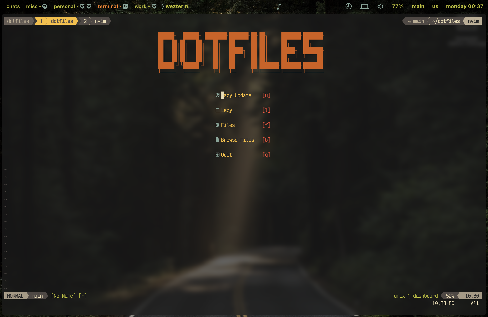
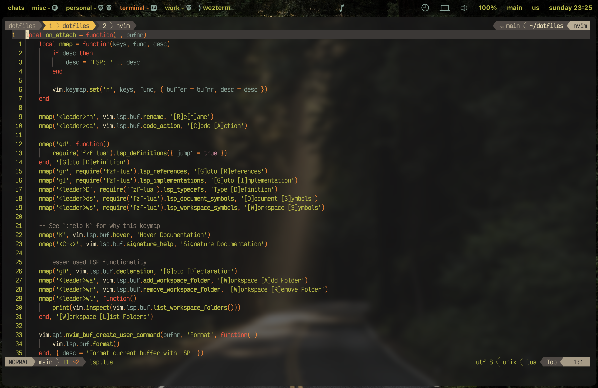
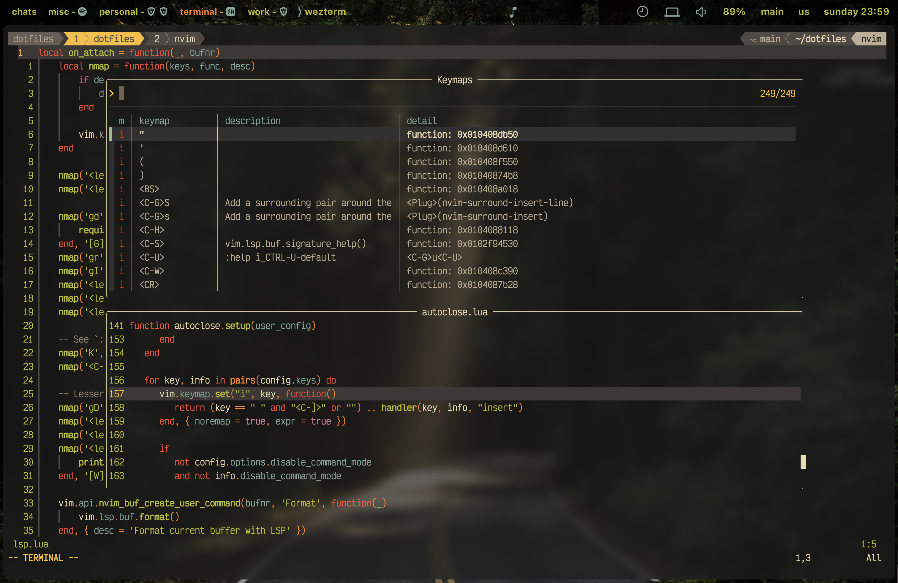

# nvim

 

    

# plugins

- [blink.cmp](https://github.com/saghen/blink.cmp)
- [conform.nvim](https://github.com/stevearc/conform.nvim)
- [fzf-lua](https://github.com/ibhagwan/fzf-lua)
- [gitsigns.nvim](https://github.com/lewis6991/gitsigns.nvim)
- [gruvbox.nvim](https://github.com/ellisonleao/gruvbox.nvim)
- [kulala.nvim](https://github.com/dont-be-evil-company/kulala.nvim)
- [mini.ai](https://github.com/nvim-mini/mini.ai)
- [mini.files](https://github.com/nvim-mini/mini.files)
- [mini.icons](https://github.com/nvim-mini/mini.icons)
- [mini.pairs](https://github.com/nvim-mini/mini.pairs)
- [mini.surround](https://github.com/nvim-mini/mini.surround)
- [nvim-treesitter-textobjects](https://github.com/nvim-treesitter/nvim-treesitter-textobjects)
- [nvim-treesitter](https://github.com/nvim-treesitter/nvim-treesitter)
- [nvim-ts-autotag](https://github.com/windwp/nvim-ts-autotag)
- [vim-fugitive](https://github.com/tpope/vim-fugitive)

# custom plugins

- [nvim-tmux-navigatior.lua](.config/shared/nvim/lua/plugins/custom-plugins/nvim-tmux-navigatior.lua)
- [sessions-manager.lua](.config/shared/nvim/lua/plugins/custom-plugins/sessions-manager.lua)
- [sql-runner.lua](.config/shared/nvim/lua/plugins/custom-plugins/sql-runner.lua)
- [statusline.lua](.config/shared/nvim/lua/plugins/custom-plugins/statusline.lua)
- [tabline.lua](.config/shared/nvim/lua/plugins/custom-plugins/tabline.lua)
- [yazi-file-explorer.lua](.config/shared/nvim/lua/plugins/custom-plugins/yazi-file-explorer.lua)