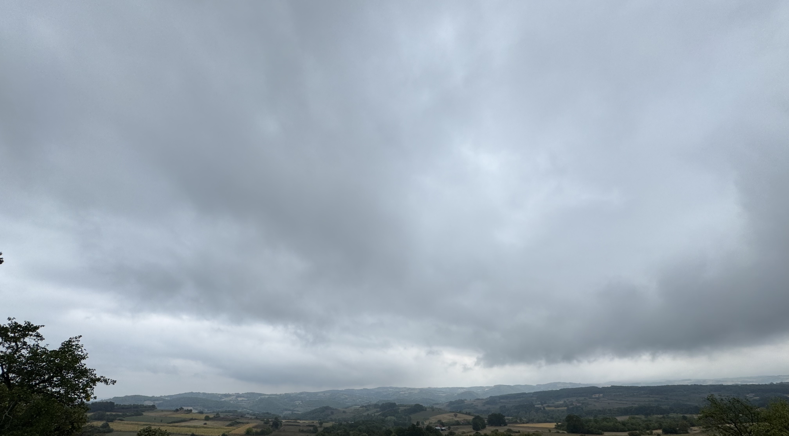
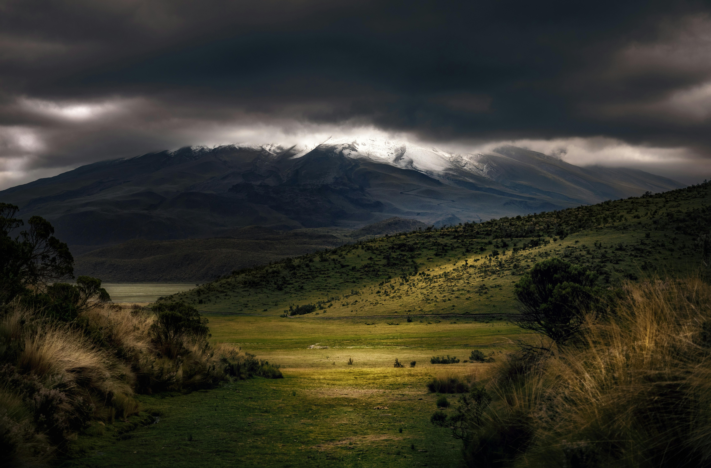
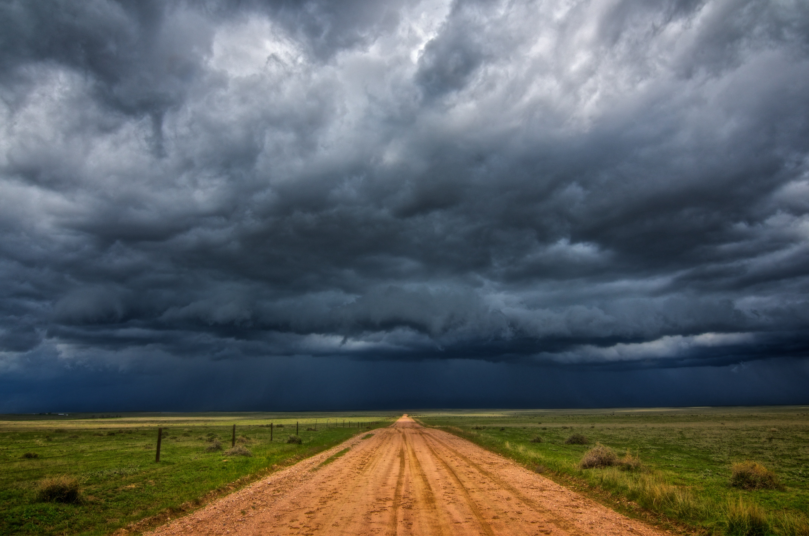

# desktop


# [neovim](.config/shared/nvim/)


# [wallpapers](wallpapers)
<p align="center">
  
  
  
  
  
  
  
  
  
  
  
  
  
  
  
  
  
  
  
  
  
  
  
  
  
  
  
  
  
  
  
  
  
  
  
  
  
  
  
  
</p>

# tools
## clis
- [bat](https://github.com/sharkdp/bat) - cat replacement with syntax highlighting
- [brew](https://github.com/Homebrew/brew) - macOS package manager
- [delta](https://github.com/dandavison/delta) - syntax highlighting pager for git, diff, grep and blame
- [eza](https://github.com/eza-community/eza) - alternative for ls
- [figlet](https://github.com/cmatsuoka/figlet) - used for generating ASCII art from text input
- [fzf](https://github.com/junegunn/fzf) - command-line fuzzy finder
- [git](https://github.com/git/git) - version control
- [gitleaks](https://github.com/gitleaks/gitleaks) - find secrets in git commits
- [gitmux](https://github.com/arl/gitmux) - git status for tmux status bar
- [jq](https://github.com/jqlang/jq) - command line json parser
- [nvim](https://github.com/neovim/neovim) - text editor
- [tmux](https://github.com/tmux/tmux) - terminal multiplexer
- [zoxide](https://github.com/ajeetdsouza/zoxide) - smart cd command
- [zsh](https://github.com/zsh-users/zsh) - z shell
- [switchaudio-osx](https://github.com/deweller/switchaudio-osx) - change audio output via command line

## tuis
- [btop](https://github.com/aristocratos/btop) - monitor resources
- [lazygit](https://github.com/jesseduffield/lazygit) - git TUI
- [spotify-player](https://github.com/aome510/spotify-player) - TUI for Spotify
- [visidata](https://github.com/saulpw/visidata) - terminal spreadsheet tool
- [yazi](https://github.com/sxyazi/yazi) - terminal file manager

## tiling manager
#### macos
- [aerospace](https://github.com/nikitabobko/AeroSpace) - tiling manager
- [borders](https://github.com/FelixKratz/JankyBorders) - creating colored border around focused window

## guis
#### macos
- [choose](https://github.com/chipsenkbeil/choose) - cli fuzzy matcher that has native macOS GUI - using this as app launcher
- [maccy](https://github.com/p0deje/Maccy) - clipboard history manager
- [sketchybar](https://github.com/FelixKratz/SketchyBar) - customizable macOS status bar replacement - using [SbarLua](https://github.com/FelixKratz/SbarLua)

## automation/scripting
- [kanata](https://github.com/jtroo/kanata) - cross platform keyboard customization
- [mouseless](https://mouseless.click/) - mouse control via keyboard - paid app
- [hammerspoon](https://github.com/Hammerspoon/hammerspoon) - tool for automation of macOS, uses Lua
- [karabiner](https://github.com/pqrs-org/Karabiner-Elements) - keyboard customization for macOS

## fonts
- [caskaydia-cove-nerd-font](https://github.com/ryanoasis/nerd-fonts/tree/master/patched-fonts/CascadiaCode) - `brew install --cask font-caskaydia-cove-nerd-font`
- [caskaydia-mono-nerd-font](https://github.com/ryanoasis/nerd-fonts/tree/master/patched-fonts/CascadiaMono) - `brew install --cask font-caskaydia-mono-nerd-font`
- [fira-mono-nerd-font](https://github.com/ryanoasis/nerd-fonts/tree/master/patched-fonts/FiraMono) - `brew install --cask font-fira-mono-nerd-font`
- [iosevka-nerd-font](https://github.com/ryanoasis/nerd-fonts/tree/master/patched-fonts/Iosevka) - `brew install --cask font-iosevka-nerd-font`
- [sf-mono-nerd-font-ligaturized](https://github.com/shaunsingh/SFMono-Nerd-Font-Ligaturized) - `brew install --cask font-sf-mono-nerd-font-ligaturized`
- [sf-mono](https://developer.apple.com/fonts/) - ```brew install --cask font-sf-mono```
- [sf-pro](https://developer.apple.com/fonts/) - `brew install --cask font-sf-pro`
- [victor-mono-nerd-font](https://github.com/ryanoasis/nerd-fonts/tree/master/patched-fonts/VictorMono) - `brew install --cask font-victor-mono-nerd-font`

## symbol only fonts
- [symbols-only-nerd-font](https://github.com/ryanoasis/nerd-fonts/tree/master/patched-fonts/NerdFontsSymbolsOnly) - `brew install --cask font-symbols-only-nerd-font`
- [sf-symbols](https://developer.apple.com/sf-symbols/) - `brew install --cask sf-symbols`

# Installation

- I would not suggest installing everything since this is a config that I personally use and many things here are tailored to my needs. You can check the code and use whatever you find here in your dotfiles. But if you really want to install them here are the steps:

- install [nix](https://github.com/NixOS/nix) and [nix-darwin](https://github.com/nix-darwin/nix-darwin) - run `sudo darwin-rebuild switch --flake ~/projects/dotfiles/.config/nix-darwin#macbook`
- run the `install.sh` script that should install everything that's needed.
